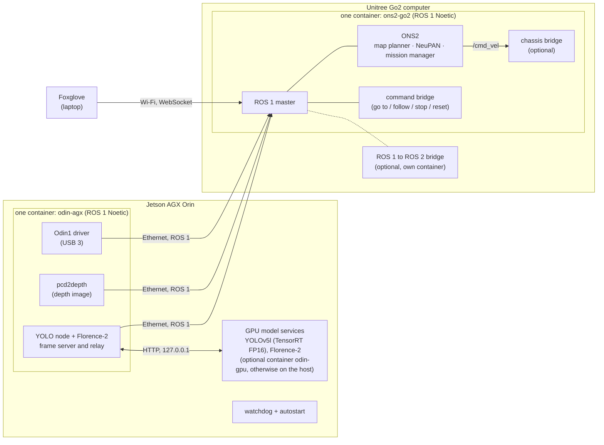

# ONS2 on a Unitree Go2 with the Odin1 on a Jetson AGX Orin

This branch adapts **Odin Navigation Stack 2 (ONS2)** to a Unitree Go2 where the Odin1 sensor and the
perception models run on an external **NVIDIA Jetson AGX Orin**, while navigation runs on the Go2's own computer.
It adds a GPU object detector (YOLOv5l with TensorRT), open-vocabulary search with Florence-2, "go to" / "follow" commands from Foxglove,
extra safety limits for walking among people, and automatic recovery of the sensor pipeline.

Everything upstream keeps working: the changes are a new robot profile, new scripts and launch files, and one
small fix in an upstream file. Based on upstream commit `19654eb`.

---

## 1. Architecture



| Machine | Runs |
|---|---|
| **Jetson AGX Orin** | One container `odin-agx` with the Odin1 driver (the color camera needs USB 3), depth image, YOLO detector node, Florence-2 frame server and relay (separate processes inside it). The YOLOv5l (TensorRT) and Florence-2 GPU services run on the host, or in the optional container `odin-gpu` (see §GPU container). On the host: watchdog and autostart services |
| **Go2 computer** | One container `ons2-go2` with the ROS 1 master, ONS2, command bridge, optional chassis bridge and Foxglove bridge (separate processes inside it; host ROS 2 untouched). Optional, only for the remote web monitor: a second container `odin-bridge` (ROS 1 ↔ ROS 2) |
| **Laptop** | Foxglove layout with command panels and STOP / RESET buttons |

---

## 2. Changes inside the ONS2 tree

### 2.1 Upstream file modified (1)

| File | Change |
|---|---|
| `ros_ws/src/yolo_ros/scripts/yolo_detector.py` | **Color fix:** YOLOv5 expects RGB but received BGR (red and blue swapped), which hurt detection. **Confidence threshold** is now a parameter (`~conf_thres`, default 0.25) and can be changed live on `/yolo/set_conf`. |

### 2.2 New robot profile `robots/go2_agx/`

A copy of `robots/go2/` with:

| File | Change |
|---|---|
| `robot.yaml` | Odin1 on the AGX; chassis bridge disabled by default (enabled only on request, see §4). |
| `neupan/config.yaml` | **No reverse:** `output_gain` enabled with `v_bwd_gain: 0.0`. Forward and turning are unchanged; NeuPAN turns in place instead of backing up, because nothing watches behind the robot. |
| `neupan/planner.yaml` | **Slower for indoor use around people:** `ref_speed 0.4`, `max_speed [0.4, 0.6]` (upstream 0.625 / [0.625, 0.875]). Braking (`max_acce`) unchanged. |

### 2.3 New scripts and launch files

| File | Purpose |
|---|---|
| `scripts/ons2_go2_agx.sh` | ONS2 launcher for this setup. Same tmux windows, gates and mission manager as `ons2_go2.sh`, but the Odin1 is remote (its gates only check the data) and it reuses the existing ROS master. |
| `scripts/yolo_cmd_bridge.py` | Foxglove command interface: object list, go to, follow, multi-stop missions, Florence-2 objects, stop, reset (see §3). |
| `scripts/yolo_debug_compress.py` | Republishes the raw YOLO debug image as a small JPEG so Foxglove can show it over Wi-Fi. |
| `scripts/cloud_view.py` | Lightweight point clouds for Foxglove over Wi-Fi (downsampled live cloud and map cloud). |
| `scripts/go2_body_marker.py` | Draws the Go2 body and heading in Foxglove / RViz. |
| `ros_ws/src/ons2_bringup/launch/no_bridge.launch` | Empty chassis bridge: run the whole stack with nothing moving the legs. |
| `ros_ws/src/yolo_ros/launch/yolo_query_only.launch` | `yolo_detection.launch` without the detector (it runs on the AGX GPU). |

---

## 3. Commands from Foxglove

### `/yolo/command` (std_msgs/String) → answers on `/yolo/console`

| Command | Action |
|---|---|
| `list` | Numbered list of detected objects with distance and direction from the robot |
| `go 2` | Walk to object #2 and stop in front of it, facing it |
| `follow 1` | Follow object #1 (e.g. a person) using the mission manager's dynamic mode |
| `go F1` | Walk to object F1 found by Florence-2 |
| `go F1 3 F2 wait 5` | One mission with several stops in that order, waiting at each |
| `stop` | Stop everything that moves the robot (follow, mission, NeuPAN, turns); keeps the lists |
| `reset` / `clear` | Stop, and also clear what could be reused later: the latched last route, object numbers, Florence objects and markers |
| `forget` | Forget the Florence-2 objects |

### `/florence/command` (std_msgs/String) → answers on `/florence/result`

| Command | Action |
|---|---|
| `chair`, `fire extinguisher`, … | Search any English word; results numbered and drawn on `/inspection/annotated/compressed` |
| `far chair` | Look farther with tiles of the image (~12 s) |
| `describe 2`, `check chair`, `show` | Describe / check / show results |
| `all` | Run the full checklist (`FLORENCE_CHECKLIST`) |
| `send on` · `send off` · `send 2 3` · `send all` | Pass Florence results to the command bridge as F1, F2 … (automatic by default) |
| `clean` | Remove all F objects and their markers |

Florence objects get their distance from the lidar depth image at the moment of the photo and are placed on the
map, so they can be used by `go F#`.

---

## 4. Safety

- **Chassis bridge is opt-in.** Without `--with-bridge` the stack publishes `/cmd_vel` but nothing moves the legs.
  With it, the upstream Go2 bridge **stands the robot up at start**: keep the remote control in hand.
- **No reverse and lower speed** in the NeuPAN profile (§2.2).
- **Follow uses fresh detections only**, placed on the map with the transform at the time of the photo; goals are
  sent only when the person is in front of the robot and beyond the stop distance, otherwise the robot stops and waits.
- **Manual takeover:** if the operator moves the robot with the remote while following, follow stops instead of
  pulling the robot back.
- **`stop` and `reset`** buttons in the Foxglove layout. `reset` also replaces the latched route, so a restarted
  planner cannot resume an old goal.
- **Follow log:** every follow decision and every non-zero `/cmd_vel` with its publisher is written to a log on
  the Go2, to diagnose unexpected motion.

---

## 5. Deployment files in `go2_agx/`

| Path | Contents |
|---|---|
| `go2/` | `start_odin_remote.sh` / `stop_odin_remote.sh` (create / remove the container `ons2-go2` with the ROS 1 master), `ons2_start.sh` / `ons2_stop.sh` (start / stop ONS2 inside it), `Dockerfile` (image `ons2:go2`), `start_bridge.sh` / `stop_bridge.sh` (optional ROS 1 ↔ ROS 2 bridge, container `odin-bridge`), `fastdds_udp.xml` (for the bridge), `remote_monitor_start.sh` (upstream web monitor on the Go2 host) |
| `agx/` | `agx_lib.sh` (helpers for the single container `odin-agx`, one process per component, and for the optional container `odin-gpu`), `start_odin_agx.sh` / `stop_odin_agx.sh` (creates the container, starts / stops the Odin1 driver), `start_depth_agx.sh`, `start_yolo_gpu_agx.sh` / `stop_yolo_gpu_agx.sh`, `start_perception_agx.sh` (Florence-2), `florence_service.py`, `florence_cmd_relay.py`, `cam_stream.py` (MJPEG camera view), `fix_odin_usb.sh`, `control_command_agx.yaml`, `odin_depth.launch`, `checklist.example.yaml` (for the Florence command `all`) |
| `agx/yolo_gpu/` | `yolo_gpu_service.py` (YOLOv5l on the GPU, HTTP on 127.0.0.1), `yolo_detector_gpu.py` (ROS node, same topics as upstream `yolo_detector`), `yolo5_stubs.py` |
| `agx/yolo_trt/` | `export_onnx.py` (YOLOv5l → ONNX), `yolo_trt_service.py` (same HTTP API as `yolo_gpu_service.py`, TensorRT engine), `compare.py` (PyTorch vs TensorRT on the same images) |
| `agx/system/` | `odin_watchdog.sh`, `odin_autostart.sh`, `odin_usb_tuning.sh`, their systemd units and the udev rule |
| `agx/docker/` | `Dockerfile.driver` (image `odin-drv:0144`, build base), `Dockerfile.yolo` (image `odin-yolo:0144`, the image the container `odin-agx` runs), `Dockerfile.gpu` (image `odin-gpu:go2`, the optional container for the GPU model services) |
| `foxglove/` | Layout with 3D view, camera / YOLO / Florence images, command panels and STOP / RESET buttons |
| `patches/` | `odin-perception-annotation-boxes.patch` (separate `Odin-perception` repository: boxes were never drawn on the annotated image) and `odin_ros_driver-optional-no-raw-rgb.patch` (optional switch to publish only the compressed image) |

**One container (AGX):** all ROS 1 parts run in `odin-agx` as processes named `driver`, `cam`, `depth`, `yolo`,
`capture` and `relay`. Each has a pid file and a "wanted" mark in `/run/odin/` and a log in `~/odin_test/logs/agx/`.
Restarting the driver keeps the container and the other processes. The GPU model services (YOLOv5l TensorRT/PyTorch,
Florence-2) are not in this container: it is ROS Noetic (Python 3.8) and the JetPack 6 GPU wheels are Python 3.10. They run
in the optional container `odin-gpu` when its image exists, otherwise on the host (see §GPU container).

**Watchdog (AGX):** restarts the Odin1 driver if odometry stops (cancelling any mission first and resetting the USB
hub if needed), and relaunches the depth, YOLO and Florence processes if they crash or lose the ROS master.
**Autostart (AGX):** at boot, waits for the Odin1, the Ethernet link and the ROS master, then starts everything in
order with retries.

**YOLO on TensorRT (AGX):** `start_yolo_gpu_agx.sh` serves YOLOv5l from a TensorRT FP16 engine when it exists, and
falls back to the PyTorch service by itself if the engine is missing or does not load. Measured on the AGX in the
30 W power mode, with Florence-2 sharing the GPU: about 45–50 ms per image instead of 300–430 ms, so the detector
keeps up with the camera (~10 Hz, ~0.15 s latency, before ~4 Hz and ~0.3 s), with the same detections
(47 of 47 on the test images, confidence within ±0.01).

---

## 6. Installation

The scripts expect these locations (they can be changed inside the scripts).

**Go2 computer, quick path** (on the Go2, from a clone of this repository; no sudo):
```bash
./go2_agx/install.sh --check      # host check: JetPack 6, docker + nvidia runtime, disk, internet, Odin1, images, map
./go2_agx/build_images.sh         # the images (about 40 GB, long)
./go2_agx/install.sh --ons2 --engine   # submodules, scripts, network.env, YOLO folders + weights, ~/ons2 build, TensorRT engine
```
`install.sh` copies the scripts to `~/odin_test`, `~/ons2_docker` and `~/odin_nav_stack/drv0144`, creates `network.env` and
`control_command_agx.yaml` if missing (never overwrites them), downloads the official YOLOv5l weights (`agx/yolo_trt/get_weights.sh`, checked by
sha256) and can build the TensorRT engine inside `odin-gpu` (`agx/yolo_trt/build_engine.sh`, no TensorRT on the host). You still copy the map file
yourself, and the optional watchdog needs sudo. `install.sh --check` was run on the Go2; the install, `--ons2` and `--engine` steps are written
but **not tested yet**. The manual steps below are what it does.

**Go2 computer**
1. This repository at `~/ons2`, built inside the container as upstream describes.
2. `go2_agx/go2/ons2_*.sh`, `remote_monitor_start.sh` and `Dockerfile` in `~/ons2_docker/`;
   `start_odin_remote.sh`, `stop_odin_remote.sh`, `start_bridge.sh`, `stop_bridge.sh` and `fastdds_udp.xml` in
   `~/odin_nav_stack/drv0144/`.
3. Images: `./go2_agx/build_images.sh` builds all four in order: `odin-nav:drv0144` (`docker/Dockerfile.global` on
   `dustynv/ros:noetic-pytorch-l4t-r35.3.1`), `ons2:go2`, `odin-drv:0144` + `odin-yolo:0144`, `odin-gpu:go2`. It needs about 40 GB
   free and skips images that exist; `BASE_TAG=odin-nav:drv0144-rebuilt` builds a test copy. The base recipe was read from `docker history`
   of the working image. On 27 Nov 2026 the base and `ons2:go2` were rebuilt from the repo on the Go2 and `test_stack.sh all` and
   `verify --resilience` passed on them (run on the Go2 with `GO2_SSH=local`). Known differences from the older image: `scs` 3.3.2 (was
   3.2.11), no `netifaces`; driving with the chassis was not compared yet. `odin-drv`, `odin-yolo` and `odin-gpu` were not rebuilt in that test. `ros1_bridge:go2` (optional bridge) is still from ONS1.

**Jetson AGX Orin**
1. `go2_agx/agx/*` in `~/odin_test/`; the `yolov5` submodule copied to `~/odin_test/yolo_gpu/yolov5`.
2. Images `odin-drv:0144` and then `odin-yolo:0144` (see `agx/docker/`); the container runs the second.
3. [Odin-perception](https://github.com/ManifoldTechLtd/Odin-perception) in `~/odin-perception` with its CUDA
   virtual environment and the Florence-2 model, plus `patches/odin-perception-annotation-boxes.patch`.
4. YOLOv5l weights (path in `YOLO_WEIGHTS`) and your relocalization map as
   `~/odin_test/maps/relocalization/map.bin`.
5. A static address (`AGX_IP`) on the Ethernet port to the Go2 (NetworkManager profile `go2-net`) and the network file (§8).
6. Optional services: `agx/system/*.sh` in `/usr/local/bin/`, `*.service` in `/etc/systemd/system/`, the udev rule
   in `/etc/udev/rules.d/`, then `systemctl enable odin-usb-tuning odin-watchdog odin-autostart`.
7. Optional Florence-2 checklist: `agx/checklist.example.yaml` as `~/perception_test/checklist.yaml`.
8. TensorRT engine (optional but recommended; about 15 minutes of GPU, with the robot idle), in `~/odin_test/yolo_trt`:
   ```bash
   ~/odin-perception/.venv/bin/python export_onnx.py
   /usr/src/tensorrt/bin/trtexec --onnx=yolov5l.onnx --saveEngine=yolov5l_fp16.engine --fp16 \
     --minShapes=images:1x3x256x256 --optShapes=images:1x3x544x640 --maxShapes=images:1x3x640x640 \
     --memPoolSize=workspace:2048
   ```
   To compare it with the PyTorch service first, run it on port 8751
   (`YOLO_GPU_PORT=8751 ~/odin-perception/.venv/bin/python yolo_trt_service.py`) and then `compare.py`.
   Rebuild the engine after a JetPack / TensorRT update; until then the PyTorch fallback is used.

**Both machines**
- Keep the clocks of the Go2 and the AGX synchronized (NTP, e.g. systemd-timesyncd with a short poll interval):
  ROS combines time stamps from both machines, and an offset moves objects to the wrong place on the map.
- AGX Ethernet profile to the Go2, for example:
  `nmcli con add type ethernet ifname eno1 con-name go2-net ipv4.method manual ipv4.addresses <AGX_IP>/24 ipv4.never-default yes`

**Publishing the images to AWS ECR, and using them on another Go2** (`push_images.sh`, `pull_images.sh`)

The three images that run the stack (`ons2:go2`, `odin-yolo:0144`, `odin-gpu:go2`) are `arm64`. A repository may hold several images, so there are two layouts: **one private repository each** (default: `<PREFIX>/odin_ons2`, `odin_yolo`, `odin_gpu`, prefix `robotics`, tag = the version), or **all three in one existing repository** with `REPO=<name>` (tags `ons2-<VERSION>`, `yolo-<VERSION>`, `gpu-<VERSION>`). They are large (24, 6 and 19 GB on disk, the upload is tens of GB), so run the push on the Go2 itself.

1. Create the repository (or the three) once, private, ideally with **tag immutability on** and scan on push on, in the console or with `--create-repos` (which creates them that way). In a repository that allows overwriting tags, the script still refuses to push a tag that already exists.
2. Log in to AWS yourself (`aws sso login`, or export keys in the shell; nothing is read from or written to a file by the scripts).
3. On the machine with the images:
   ```
   export REGISTRY=<account>.dkr.ecr.<region>.amazonaws.com VERSION=1.0.0
   ./go2_agx/push_images.sh                    # dry run: checks the images, prints what it would push, pushes nothing
   ./go2_agx/push_images.sh --push             # logs in to ECR and pushes (add --create-repos if the repositories do not exist)
   ```
   It refuses `VERSION=latest` and a version that already exists in ECR, and prints the digest of each pushed image.
4. On a new Go2 (instead of `build_images.sh`):
   ```
   ./go2_agx/pull_images.sh                    # pulls the three and retags them to the local names; --force replaces existing ones
   ./go2_agx/install.sh --check && ./go2_agx/install.sh --ons2 --engine
   ```

Not in the images, so still needed on a new Go2: the ONS2 workspace in `~/ons2` (`install.sh --ons2`), the scripts, YOLO weights and engine, the maps and the configs. `ros1_bridge:go2` (cloud link) has no Dockerfile in this repo and is not covered by these scripts. YOLOv5 code (AGPL) is inside the images: fine for a private registry, check before sharing outside the company. The scripts were checked only as a dry run against a stand-in `docker`; the first real push has not been done.

---

## 7. Start-up order

1. **Go2:** start the container `ons2-go2` with the ROS master: `~/odin_nav_stack/drv0144/start_odin_remote.sh`
   (add `--with-bridge` only if you use the remote web monitor).
2. **AGX:** power it on. The autostart service brings up the Odin1 driver (relocalization), depth, YOLO and
   Florence-2 in about 1–2 minutes (by hand: `start_odin_agx.sh go2`, `start_depth_agx.sh`,
   `start_yolo_gpu_agx.sh`, `start_perception_agx.sh`).
3. **Go2:** start ONS2: `~/ons2_docker/ons2_start.sh --map=<map_name> --with-yolo-agx`, adding `--with-bridge` only
   when the robot should walk. Add `--with-cloud` to also run `cloud_publisher` (JSON for the cloud link, see `cloud/README.md`;
   it also starts the ROS 1 → ROS 2 bridge `odin-bridge` if needed). The cloud side itself is the Pulse profile in ardia-robotics.
4. **Laptop:** open Foxglove, connect to `ws://<GO2_WIFI_IP>:8765` and import the layout from `foxglove/`.

Stop with `ons2_stop.sh` on the Go2 (only ONS2; the container and the master keep running), `stop_odin_agx.sh all` on the AGX
(it also removes `odin-gpu`; without `all` it stops only the driver) and `stop_odin_remote.sh` on the Go2 (master and container).

### AGX container `odin-agx`

All ROS 1 parts of the AGX run in this one container (see §5). `start_odin_agx.sh` creates it; the other start scripts
add processes to it and need the driver running first. Nothing needs to be started inside by hand.

| Process | Started by | Log (host, `~/odin_test/logs/agx/`) |
|---|---|---|
| `driver`, `cam` | `start_odin_agx.sh go2` | `driver.log`, `cam.log` |
| `depth` | `start_depth_agx.sh` | `depth.log` |
| `yolo` | `start_yolo_gpu_agx.sh` | `yolo.log` (the GPU service logs to `~/odin_test/logs/yolo_gpu_service.log`) |
| `capture`, `relay` | `start_perception_agx.sh` | `capture.log`, `relay.log` |

```bash
docker exec odin-agx ls /run/odin                 # processes started (NAME.pid) and wanted (NAME.on)
docker exec odin-agx bash -c "source /opt/ros/noetic/setup.bash; rosnode list"   # ROS nodes
tail -f ~/odin_test/logs/agx/driver.log           # follow one component
~/odin_test/stop_odin_agx.sh depth                # stop the driver + camera + depth (also: perception, all)
~/odin_test/stop_yolo_gpu_agx.sh                  # stop the YOLO node and its GPU service
```

- **Restarting the driver** (by hand or by the watchdog) keeps the container and the other processes.
  Re-running a start script restarts only its own process. The watchdog relaunches a process that died, but not one
  you stopped on purpose.
- **Changed `control_command_agx.yaml`, the relocalization map or the mounts:** these are fixed when the container is
  created. Apply them with `stop_odin_agx.sh all` and then start again. The same happens by itself if the ROS master
  address changes.
- **Moving from the old setup** (five containers `odin-agx`, `odin-depth`, `odin-yolo-gpu`, `odin-perception-cap`,
  `odin-perception-cmd`): the first `start_odin_agx.sh` removes them and creates the single container. Copy
  `agx/*` (including `agx_lib.sh`) to `~/odin_test/`, `agx/system/*.sh` to `/usr/local/bin/`, and run
  `sudo systemctl restart odin-watchdog`.
- **GPU services are not in `odin-agx`** (Python 3.10 wheels): the YOLOv5l TensorRT / PyTorch service and Florence-2 run in
  `odin-gpu` or on the host, so `docker logs` is no longer where to look; use the log files: in `odin-gpu`
  `~/odin_test/logs/gpu/yolosvc.log` and `florence.log`, on the host `~/odin_test/logs/yolo_gpu_service.log` and
  `~/perception_test/florence_service.log`.

### Everything on the Go2 Jetson (no AGX)

The same two containers can run on the Go2 itself: `ons2-go2` (ROS master + ONS2) and `odin-agx` (Odin1 driver, camera
stream, depth). Only the Go2 needs `network.env`, and `AGX_IP` can stay empty.

1. Copy `go2_agx/agx/*` to `~/odin_test/` on the Go2, link the maps (`ln -s ~/odin_nav_stack/docker/maps ~/odin_test/maps`) and
   load the image `odin-yolo:0144` (`docker save` on the AGX, `docker load` on the Go2).
2. `start_odin_remote.sh`, then `~/odin_test/start_odin_agx.sh same` (the mode `same` joins the master of `ons2-go2` on this
   machine; no cable wait), then `start_depth_agx.sh`, then `ons2_start.sh --map=<map_name> --with-yolo`.
3. YOLO runs on the CPU (ONS2's own YOLOv5s, about 1-4 Hz) and there is no Florence-2, unless the GPU environment of the AGX is
   installed on the Go2 too (`~/odin-perception` with its venv and the Florence-2 model, the YOLOv5l weights and the TensorRT
   engine, see §GPU container); then use `start_yolo_gpu_agx.sh`, `start_perception_agx.sh` and `--with-yolo-agx` as in §7.
   Measured on the Go2 (Orin NX, JetPack 6.2): the YOLO debug image runs at about 10 Hz with the GPU path and 1-4 Hz on the CPU.

The watchdog and autostart detect this mode by themselves (the master address belongs to this machine) and skip the GPU
parts when `~/odin-perception/.venv` does not exist.

### GPU container `odin-gpu` (optional third container)

Runs the two GPU model services, as the processes `yolosvc` (YOLOv5l TensorRT, port 8750) and `florence` (Florence-2, port 8740),
instead of running them on the host. The ROS side stays in `odin-agx` (`yolo`, `capture`, `relay`). Host network, so the addresses
`127.0.0.1:8750` / `:8740` do not change.

- **Image:** `odin-gpu:go2`, from `agx/docker/Dockerfile.gpu` (NVIDIA JetPack 6.1 image: CUDA 12.6, cuDNN 9, TensorRT 10.3, Python 3.10). It also
  holds the whole Odin-perception setup: cuSPARSELt, a virtualenv with torch 2.8 (Jetson wheel) and the packages pinned in
  `agx/docker/perception-requirements.txt`, the Odin-perception code at a pinned commit with `patches/odin-perception-annotation-boxes.patch`,
  and the Florence-2 model at a pinned revision (downloaded while building; later runs need no internet). Label `odin.perception=baked`.
  Build once from the repository root (internet needed): `docker build -f go2_agx/agx/docker/Dockerfile.gpu -t odin-gpu:go2 .`
  (`odin-yolo:0144` has the same Odin-perception code baked in for the frame server).
- **Needs on the host:** the Docker `nvidia` runtime (it mounts only the GPU driver; CUDA, cuDNN, TensorRT and Odin-perception come from the
  images), a JetPack 6.x host, and `~/odin_test` (service code, YOLOv5l weights, the TensorRT engine, mounted at the same path). An older
  image without the label still gets `~/odin-perception` mounted from the host, as before.
- **Selection:** `start_yolo_gpu_agx.sh` and `start_perception_agx.sh` use the container when the image exists (created on first use) and the host otherwise.
  Force one with `GPU_MODE=container` or `GPU_MODE=host`. A copy of a service left on the host is stopped first (it would hold the port).
- **Stop:** `stop_yolo_gpu_agx.sh` stops the YOLO service (the container stays); `stop_odin_agx.sh all` removes the container.
- **TensorRT engine:** it only loads with the TensorRT version that built it. On the Go2 the image has TensorRT 10.3.0, the same as the host
  (JetPack 6.2), and it loaded the engine built on the host; with another version, rebuild the engine (§ Jetson AGX Orin, step 8).
- **Tested on the Go2** (26 Nov 2026): PyTorch sees the GPU inside the container, `test_stack.sh verify` expects the three containers and
  checks `yolosvc` and `florence`, and a Florence-2 search followed by `go F1` walked the robot to the object.

### Test script

`go2_agx/test_stack.sh` starts and checks everything from a PC with SSH access (`STACK=single` for everything on the Go2,
`STACK=two` for AGX + Go2): `check`, `deploy`, `start`, `verify [--resilience]`, `stop`, `all`. It never starts the chassis
bridge (so with the bridge running by hand, its safety check fails on purpose). With the image `odin-gpu:go2` on the machine and the GPU path it expects three
containers (`odin-agx`, `ons2-go2`, `odin-gpu`) and checks their processes; `GPU_MODE=host` forces the host mode. SSH targets and passwords come from the environment (`GO2_SSH`, `GO2_SSHPASS`, ...); see the header of the script. `GO2_SSH=local` runs the whole test on the Go2 itself (no SSH, no password). `CLOUD=1` also starts `cloud_publisher` (`--with-cloud`) and verifies its messages (envelope, identity, `odin.pose.v1`, `odin.status.v1`); see `cloud/README.md`.

### Go2 container `ons2-go2`

One container (image `ons2:go2`) holds the ROS 1 master and ONS2. `start_odin_remote.sh` creates it and starts the master
as the process `master`; `ons2_start.sh` then starts ONS2 inside it (tmux session `ons2_go2`). The AGX connects to the
master at `GO2_IP:11311`.

```bash
docker exec -it ons2-go2 tmux attach -t ons2_go2      # ONS2 windows (Ctrl+b d to leave)
tail -f ~/ons2/logs/master.log                        # the ROS master
~/ons2_docker/ons2_stop.sh                            # stop only ONS2 (master and AGX connection stay)
~/odin_nav_stack/drv0144/stop_odin_remote.sh          # stop master + container (the AGX loses its master)
```

- **Restarting ONS2** (`ons2_start.sh` again, `--with-bridge`, `--with-yolo-agx`...) does not touch the master, so the AGX
  stays connected. Re-running `start_odin_remote.sh` while everything runs does nothing.
- **Stopping the master** (`stop_odin_remote.sh`) stops ONS2 too. The AGX processes then register again in the new
  master; the AGX watchdog relaunches them.
- **Optional ROS 1 ↔ ROS 2 bridge** (only for `remote_monitor_start.sh`): `start_bridge.sh` / `stop_bridge.sh`, or
  `start_odin_remote.sh --with-bridge`. It is a separate container (`odin-bridge`, image `ros1_bridge:go2`, ROS Foxy) and
  is not needed for navigation.
- **Moving from the old setup** (containers `odin-master`, `odin-bridge`, `ons2-go2`): the first `start_odin_remote.sh`
  removes `odin-master` and the old `ons2-go2` and creates the new one. Copy the `go2/` scripts to the two folders of §6.

---

## 8. Configuration

**Network (required).** Copy `go2_agx/network.env.example` to `~/.config/go2_agx/network.env` on both the Go2
computer and the AGX, with the same values. The scripts stop with a message while a value is missing.

| Variable | Meaning |
|---|---|
| `GO2_IP` | Address of the Go2 computer on its internal wired network; it runs the ROS master |
| `AGX_IP` | Static address given to the AGX on the Ethernet cable to the Go2 |

**Other settings** are environment variables with defaults:

| Variable | Default | Meaning |
|---|---|---|
| `ODIN_USER` | user with UID 1000 | AGX user that owns `~/odin_test` (watchdog / autostart run as root) |
| `YOLO_WEIGHTS` | see `yolo_gpu_service.py` | YOLOv5 weights file |
| `YOLO_BACKEND` | `tensorrt` | `pytorch` forces the PyTorch service |
| `YOLO_TRT_ENGINE` | `~/odin_test/yolo_trt/yolov5l_fp16.engine` | TensorRT engine file |
| `FLORENCE_CHECKLIST` | `~/perception_test/checklist.yaml` | List used by the Florence command `all` |
| `ONS2_MAP_PCD` | `~/ons2/ros_ws/src/map_planner/maps/map.pcd` | Point cloud shown by `cloud_view.py` |
| `GO2_LOG_DIR` | `~/ons2/logs` | Logs, including the follow log |

---

## 9. Not included in this repository

- **Model weights** (YOLOv5, Florence-2): download them from their official sources. The ONNX file and the TensorRT
  engine are generated on the AGX (§6) and are specific to its TensorRT version.
- **Maps and missions** (point clouds, occupancy grids, relocalization maps, waypoint files): they are specific to
  each site; create your own with the upstream map tutorial.
- **Logs** generated at run time.
- **Local backup copies** and earlier experiments not used by this setup.
- **Site network details and credentials.**

---

## 10. Known limitations

- The Odin1 USB 3 link is sensitive to cable quality and strain; the watchdog recovers from drops but a short,
  well-secured cable is required.
- With TensorRT the detector keeps up with the camera (~10 Hz); with the PyTorch fallback it runs at about 4 Hz.
  Detection of small or partially hidden objects from the robot's low viewpoint is limited.
- Florence-2 *base* finds and describes objects but does not answer free-form questions.

---

## 11. Credits and license

Built on [Odin Navigation Stack 2](https://github.com/ManifoldTechLtd/Odin-Nav-Stack2) by Manifold Tech.

- The additions in this branch are distributed under the **GNU GPL v3.0**, like ONS2 (see `LICENSE`).
- Files copied from Apache-2.0 sources keep their original copyright and license header (or, where the original
  has none, a note of where they come from) and say what was modified: `ros_ws/src/yolo_ros/scripts/yolo_detector.py`, `ros_ws/src/yolo_ros/launch/yolo_query_only.launch`,
  `robots/go2_agx/neupan/*.yaml`, `go2_agx/agx/yolo_gpu/yolo_detector_gpu.py`, `go2_agx/agx/control_command_agx.yaml`
  and `go2_agx/agx/odin_depth.launch`.

Third-party components, used but not included here (each keeps its own license):

| Component | License | How it is used |
|---|---|---|
| [YOLOv5](https://github.com/ultralytics/yolov5) | AGPL-3.0 | upstream submodule; loaded by the YOLO GPU service |
| [NeuPAN](https://github.com/hanruihua/NeuPAN) | GPL-3.0 | part of ONS2 |
| [odin_ros_driver](https://github.com/manifoldsdk/odin_ros_driver) | Apache-2.0 | upstream submodule; built in `Dockerfile.driver` |
| [Odin-perception](https://github.com/ManifoldTechLtd/Odin-perception) | Apache-2.0 (see its `NOTICE`) | installed separately; `patches/` holds a small fix for it |
| [Florence-2](https://huggingface.co/microsoft/Florence-2-base-ft) | MIT | model weights, downloaded separately |
| [Unitree SDK2](https://github.com/unitreerobotics/unitree_sdk2) | BSD-3-Clause | downloaded when building `go2/Dockerfile` |
| [TensorRT](https://developer.nvidia.com/tensorrt) | NVIDIA proprietary, part of JetPack | used through the JetPack installation; not included |
