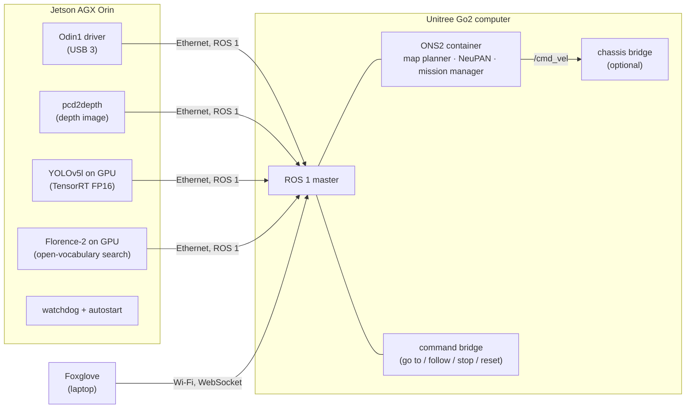

# ONS2 on a Unitree Go2 with the Odin1 on a Jetson AGX Orin

This branch adapts **Odin Navigation Stack 2 (ONS2)** to a Unitree Go2 where the Odin1 sensor and the
perception models run on an external **NVIDIA Jetson AGX Orin**, while navigation runs on the Go2's own computer.
It adds a GPU object detector (YOLOv5l with TensorRT), open-vocabulary search with Florence-2, "go to" / "follow" commands from Foxglove,
extra safety limits for walking among people, and automatic recovery of the sensor pipeline.

Everything upstream keeps working: the changes are a new robot profile, new scripts and launch files, and one
small fix in an upstream file. Based on upstream commit `19654eb`.

---

## 1. Architecture



| Machine | Runs |
|---|---|
| **Jetson AGX Orin** | Odin1 driver (the color camera needs USB 3), depth image, YOLOv5l detector on the GPU (TensorRT), Florence-2, watchdog and autostart services |
| **Go2 computer** | ROS 1 master, ONS2 (in its own container, host ROS 2 untouched), command bridge, optional chassis bridge, Foxglove bridge |
| **Laptop** | Foxglove layout with command panels and STOP / RESET buttons |

---

## 2. Changes inside the ONS2 tree

### 2.1 Upstream file modified (1)

| File | Change |
|---|---|
| `ros_ws/src/yolo_ros/scripts/yolo_detector.py` | **Color fix:** YOLOv5 expects RGB but received BGR (red and blue swapped), which hurt detection. **Confidence threshold** is now a parameter (`~conf_thres`, default 0.25) and can be changed live on `/yolo/set_conf`. |

### 2.2 New robot profile `robots/go2_agx/`

A copy of `robots/go2/` with:

| File | Change |
|---|---|
| `robot.yaml` | Odin1 on the AGX; chassis bridge disabled by default (enabled only on request, see §4). |
| `neupan/config.yaml` | **No reverse:** `output_gain` enabled with `v_bwd_gain: 0.0`. Forward and turning are unchanged; NeuPAN turns in place instead of backing up, because nothing watches behind the robot. |
| `neupan/planner.yaml` | **Slower for indoor use around people:** `ref_speed 0.4`, `max_speed [0.4, 0.6]` (upstream 0.625 / [0.625, 0.875]). Braking (`max_acce`) unchanged. |

### 2.3 New scripts and launch files

| File | Purpose |
|---|---|
| `scripts/ons2_go2_agx.sh` | ONS2 launcher for this setup. Same tmux windows, gates and mission manager as `ons2_go2.sh`, but the Odin1 is remote (its gates only check the data) and it reuses the existing ROS master. |
| `scripts/yolo_cmd_bridge.py` | Foxglove command interface: object list, go to, follow, multi-stop missions, Florence-2 objects, stop, reset (see §3). |
| `scripts/yolo_debug_compress.py` | Republishes the raw YOLO debug image as a small JPEG so Foxglove can show it over Wi-Fi. |
| `scripts/cloud_view.py` | Lightweight point clouds for Foxglove over Wi-Fi (downsampled live cloud and map cloud). |
| `scripts/go2_body_marker.py` | Draws the Go2 body and heading in Foxglove / RViz. |
| `ros_ws/src/ons2_bringup/launch/no_bridge.launch` | Empty chassis bridge: run the whole stack with nothing moving the legs. |
| `ros_ws/src/yolo_ros/launch/yolo_query_only.launch` | `yolo_detection.launch` without the detector (it runs on the AGX GPU). |

---

## 3. Commands from Foxglove

### `/yolo/command` (std_msgs/String) → answers on `/yolo/console`

| Command | Action |
|---|---|
| `list` | Numbered list of detected objects with distance and direction from the robot |
| `go 2` | Walk to object #2 and stop in front of it, facing it |
| `follow 1` | Follow object #1 (e.g. a person) using the mission manager's dynamic mode |
| `go F1` | Walk to object F1 found by Florence-2 |
| `go F1 3 F2 wait 5` | One mission with several stops in that order, waiting at each |
| `stop` | Stop everything that moves the robot (follow, mission, NeuPAN, turns); keeps the lists |
| `reset` / `clear` | Stop, and also clear what could be reused later: the latched last route, object numbers, Florence objects and markers |
| `forget` | Forget the Florence-2 objects |

### `/florence/command` (std_msgs/String) → answers on `/florence/result`

| Command | Action |
|---|---|
| `chair`, `fire extinguisher`, … | Search any English word; results numbered and drawn on `/inspection/annotated/compressed` |
| `far chair` | Look farther with tiles of the image (~12 s) |
| `describe 2`, `check chair`, `show` | Describe / check / show results |
| `all` | Run the full checklist (`FLORENCE_CHECKLIST`) |
| `send on` · `send off` · `send 2 3` · `send all` | Pass Florence results to the command bridge as F1, F2 … (automatic by default) |
| `clean` | Remove all F objects and their markers |

Florence objects get their distance from the lidar depth image at the moment of the photo and are placed on the
map, so they can be used by `go F#`.

---

## 4. Safety

- **Chassis bridge is opt-in.** Without `--with-bridge` the stack publishes `/cmd_vel` but nothing moves the legs.
  With it, the upstream Go2 bridge **stands the robot up at start**: keep the remote control in hand.
- **No reverse and lower speed** in the NeuPAN profile (§2.2).
- **Follow uses fresh detections only**, placed on the map with the transform at the time of the photo; goals are
  sent only when the person is in front of the robot and beyond the stop distance, otherwise the robot stops and waits.
- **Manual takeover:** if the operator moves the robot with the remote while following, follow stops instead of
  pulling the robot back.
- **`stop` and `reset`** buttons in the Foxglove layout. `reset` also replaces the latched route, so a restarted
  planner cannot resume an old goal.
- **Follow log:** every follow decision and every non-zero `/cmd_vel` with its publisher is written to a log on
  the Go2, to diagnose unexpected motion.

---

## 5. Deployment files in `go2_agx/`

| Path | Contents |
|---|---|
| `go2/` | `ons2_start.sh` / `ons2_stop.sh` (ONS2 container `ons2-go2`), `Dockerfile` (image `ons2:go2`), `start_odin_remote.sh` / `stop_odin_remote.sh` (ROS 1 master + ROS 1 ↔ ROS 2 bridge), `fastdds_udp.xml`, `remote_monitor_start.sh` (upstream web monitor on the Go2 host) |
| `agx/` | `start_odin_agx.sh` / `stop_odin_agx.sh` (Odin1 driver), `start_depth_agx.sh`, `start_yolo_gpu_agx.sh` / `stop_yolo_gpu_agx.sh`, `start_perception_agx.sh` (Florence-2), `florence_service.py`, `florence_cmd_relay.py`, `cam_stream.py` (MJPEG camera view), `fix_odin_usb.sh`, `control_command_agx.yaml`, `odin_depth.launch`, `checklist.example.yaml` (for the Florence command `all`) |
| `agx/yolo_gpu/` | `yolo_gpu_service.py` (YOLOv5l on the GPU, HTTP on 127.0.0.1), `yolo_detector_gpu.py` (ROS node, same topics as upstream `yolo_detector`), `yolo5_stubs.py` |
| `agx/yolo_trt/` | `export_onnx.py` (YOLOv5l → ONNX), `yolo_trt_service.py` (same HTTP API as `yolo_gpu_service.py`, TensorRT engine), `compare.py` (PyTorch vs TensorRT on the same images) |
| `agx/system/` | `odin_watchdog.sh`, `odin_autostart.sh`, `odin_usb_tuning.sh`, their systemd units and the udev rule |
| `agx/docker/` | `Dockerfile.driver` (image `odin-drv:0144`), `Dockerfile.yolo` (image `odin-yolo:0144`) |
| `foxglove/` | Layout with 3D view, camera / YOLO / Florence images, command panels and STOP / RESET buttons |
| `patches/` | `odin-perception-annotation-boxes.patch` (separate `Odin-perception` repository: boxes were never drawn on the annotated image) and `odin_ros_driver-optional-no-raw-rgb.patch` (optional switch to publish only the compressed image) |

**Watchdog (AGX):** restarts the Odin1 driver if odometry stops (cancelling any mission first and resetting the USB
hub if needed), and relaunches the depth, YOLO and Florence containers if they crash or lose the ROS master.
**Autostart (AGX):** at boot, waits for the Odin1, the Ethernet link and the ROS master, then starts everything in
order with retries.

**YOLO on TensorRT (AGX):** `start_yolo_gpu_agx.sh` serves YOLOv5l from a TensorRT FP16 engine when it exists, and
falls back to the PyTorch service by itself if the engine is missing or does not load. Measured on the AGX in the
30 W power mode, with Florence-2 sharing the GPU: about 45–50 ms per image instead of 300–430 ms, so the detector
keeps up with the camera (~10 Hz, ~0.15 s latency, before ~4 Hz and ~0.3 s), with the same detections
(47 of 47 on the test images, confidence within ±0.01).

---

## 6. Installation

The scripts expect these locations (they can be changed inside the scripts).

**Go2 computer**
1. This repository at `~/ons2`, built inside the container as upstream describes.
2. `go2_agx/go2/ons2_*.sh`, `remote_monitor_start.sh` and `Dockerfile` in `~/ons2_docker/`;
   `start_odin_remote.sh`, `stop_odin_remote.sh` and `fastdds_udp.xml` in `~/odin_nav_stack/drv0144/`.
3. Images: `ons2:go2` (see `go2/Dockerfile`), plus `odin-nav:drv0144` and `ros1_bridge:go2` from the earlier
   Odin-Nav-Stack (ONS1) Go2 setup, which are not part of this repository.

**Jetson AGX Orin**
1. `go2_agx/agx/*` in `~/odin_test/`; the `yolov5` submodule copied to `~/odin_test/yolo_gpu/yolov5`.
2. Images `odin-drv:0144` and `odin-yolo:0144` (see `agx/docker/`).
3. [Odin-perception](https://github.com/ManifoldTechLtd/Odin-perception) in `~/odin-perception` with its CUDA
   virtual environment and the Florence-2 model, plus `patches/odin-perception-annotation-boxes.patch`.
4. YOLOv5l weights (path in `YOLO_WEIGHTS`) and your relocalization map as
   `~/odin_test/maps/relocalization/map.bin`.
5. A static address (`AGX_IP`) on the Ethernet port to the Go2 (NetworkManager profile `go2-net`) and the network file (§8).
6. Optional services: `agx/system/*.sh` in `/usr/local/bin/`, `*.service` in `/etc/systemd/system/`, the udev rule
   in `/etc/udev/rules.d/`, then `systemctl enable odin-usb-tuning odin-watchdog odin-autostart`.
7. Optional Florence-2 checklist: `agx/checklist.example.yaml` as `~/perception_test/checklist.yaml`.
8. TensorRT engine (optional but recommended; about 15 minutes of GPU, with the robot idle), in `~/odin_test/yolo_trt`:
   ```bash
   ~/odin-perception/.venv/bin/python export_onnx.py
   /usr/src/tensorrt/bin/trtexec --onnx=yolov5l.onnx --saveEngine=yolov5l_fp16.engine --fp16 \
     --minShapes=images:1x3x256x256 --optShapes=images:1x3x544x640 --maxShapes=images:1x3x640x640 \
     --memPoolSize=workspace:2048
   ```
   To compare it with the PyTorch service first, run it on port 8751
   (`YOLO_GPU_PORT=8751 ~/odin-perception/.venv/bin/python yolo_trt_service.py`) and then `compare.py`.
   Rebuild the engine after a JetPack / TensorRT update; until then the PyTorch fallback is used.

**Both machines**
- Keep the clocks of the Go2 and the AGX synchronized (NTP, e.g. systemd-timesyncd with a short poll interval):
  ROS combines time stamps from both machines, and an offset moves objects to the wrong place on the map.
- AGX Ethernet profile to the Go2, for example:
  `nmcli con add type ethernet ifname eno1 con-name go2-net ipv4.method manual ipv4.addresses <AGX_IP>/24 ipv4.never-default yes`

---

## 7. Start-up order

1. **Go2:** start the ROS master and bridge: `~/odin_nav_stack/drv0144/start_odin_remote.sh`.
2. **AGX:** power it on. The autostart service brings up the Odin1 driver (relocalization), depth, YOLO and
   Florence-2 in about 1–2 minutes (by hand: `start_odin_agx.sh go2`, `start_depth_agx.sh`,
   `start_yolo_gpu_agx.sh`, `start_perception_agx.sh`).
3. **Go2:** start ONS2: `~/ons2_docker/ons2_start.sh --map=<map_name> --with-yolo-agx`, adding `--with-bridge` only
   when the robot should walk.
4. **Laptop:** open Foxglove, connect to `ws://<GO2_WIFI_IP>:8765` and import the layout from `foxglove/`.

Stop with `ons2_stop.sh` on the Go2 and `stop_odin_agx.sh` on the AGX.

---

## 8. Configuration

**Network (required).** Copy `go2_agx/network.env.example` to `~/.config/go2_agx/network.env` on both the Go2
computer and the AGX, with the same values. The scripts stop with a message while a value is missing.

| Variable | Meaning |
|---|---|
| `GO2_IP` | Address of the Go2 computer on its internal wired network; it runs the ROS master |
| `AGX_IP` | Static address given to the AGX on the Ethernet cable to the Go2 |

**Other settings** are environment variables with defaults:

| Variable | Default | Meaning |
|---|---|---|
| `ODIN_USER` | user with UID 1000 | AGX user that owns `~/odin_test` (watchdog / autostart run as root) |
| `YOLO_WEIGHTS` | see `yolo_gpu_service.py` | YOLOv5 weights file |
| `YOLO_BACKEND` | `tensorrt` | `pytorch` forces the PyTorch service |
| `YOLO_TRT_ENGINE` | `~/odin_test/yolo_trt/yolov5l_fp16.engine` | TensorRT engine file |
| `FLORENCE_CHECKLIST` | `~/perception_test/checklist.yaml` | List used by the Florence command `all` |
| `ONS2_MAP_PCD` | `~/ons2/ros_ws/src/map_planner/maps/map.pcd` | Point cloud shown by `cloud_view.py` |
| `GO2_LOG_DIR` | `~/ons2/logs` | Logs, including the follow log |

---

## 9. Not included in this repository

- **Model weights** (YOLOv5, Florence-2): download them from their official sources. The ONNX file and the TensorRT
  engine are generated on the AGX (§6) and are specific to its TensorRT version.
- **Maps and missions** (point clouds, occupancy grids, relocalization maps, waypoint files): they are specific to
  each site; create your own with the upstream map tutorial.
- **Logs** generated at run time.
- **Local backup copies** and earlier experiments not used by this setup.
- **Site network details and credentials.**

---

## 10. Known limitations

- The Odin1 USB 3 link is sensitive to cable quality and strain; the watchdog recovers from drops but a short,
  well-secured cable is required.
- With TensorRT the detector keeps up with the camera (~10 Hz); with the PyTorch fallback it runs at about 4 Hz.
  Detection of small or partially hidden objects from the robot's low viewpoint is limited.
- Florence-2 *base* finds and describes objects but does not answer free-form questions.

---

## 11. Credits and license

Built on [Odin Navigation Stack 2](https://github.com/ManifoldTechLtd/Odin-Nav-Stack2) by Manifold Tech.

- The additions in this branch are distributed under the **GNU GPL v3.0**, like ONS2 (see `LICENSE`).
- Files copied from Apache-2.0 sources keep their original copyright and license header (or, where the original
  has none, a note of where they come from) and say what was modified: `ros_ws/src/yolo_ros/scripts/yolo_detector.py`, `ros_ws/src/yolo_ros/launch/yolo_query_only.launch`,
  `robots/go2_agx/neupan/*.yaml`, `go2_agx/agx/yolo_gpu/yolo_detector_gpu.py`, `go2_agx/agx/control_command_agx.yaml`
  and `go2_agx/agx/odin_depth.launch`.

Third-party components, used but not included here (each keeps its own license):

| Component | License | How it is used |
|---|---|---|
| [YOLOv5](https://github.com/ultralytics/yolov5) | AGPL-3.0 | upstream submodule; loaded by the YOLO GPU service |
| [NeuPAN](https://github.com/hanruihua/NeuPAN) | GPL-3.0 | part of ONS2 |
| [odin_ros_driver](https://github.com/manifoldsdk/odin_ros_driver) | Apache-2.0 | upstream submodule; built in `Dockerfile.driver` |
| [Odin-perception](https://github.com/ManifoldTechLtd/Odin-perception) | Apache-2.0 (see its `NOTICE`) | installed separately; `patches/` holds a small fix for it |
| [Florence-2](https://huggingface.co/microsoft/Florence-2-base-ft) | MIT | model weights, downloaded separately |
| [Unitree SDK2](https://github.com/unitreerobotics/unitree_sdk2) | BSD-3-Clause | downloaded when building `go2/Dockerfile` |
| [TensorRT](https://developer.nvidia.com/tensorrt) | NVIDIA proprietary, part of JetPack | used through the JetPack installation; not included |
